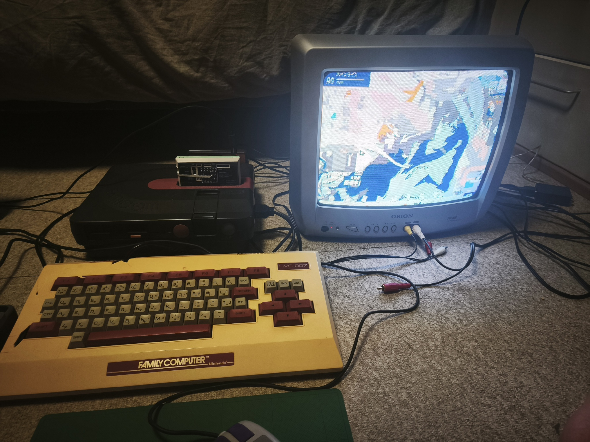
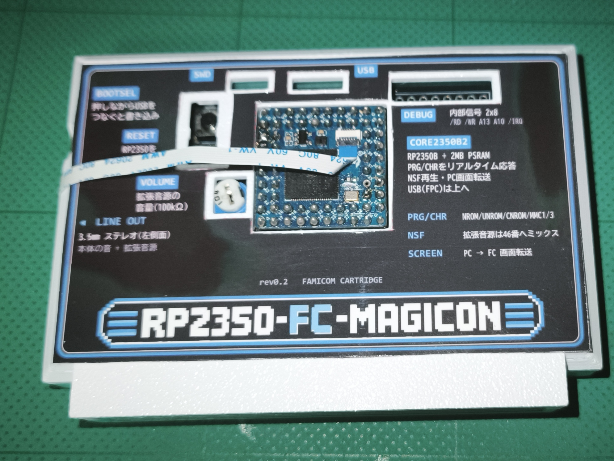
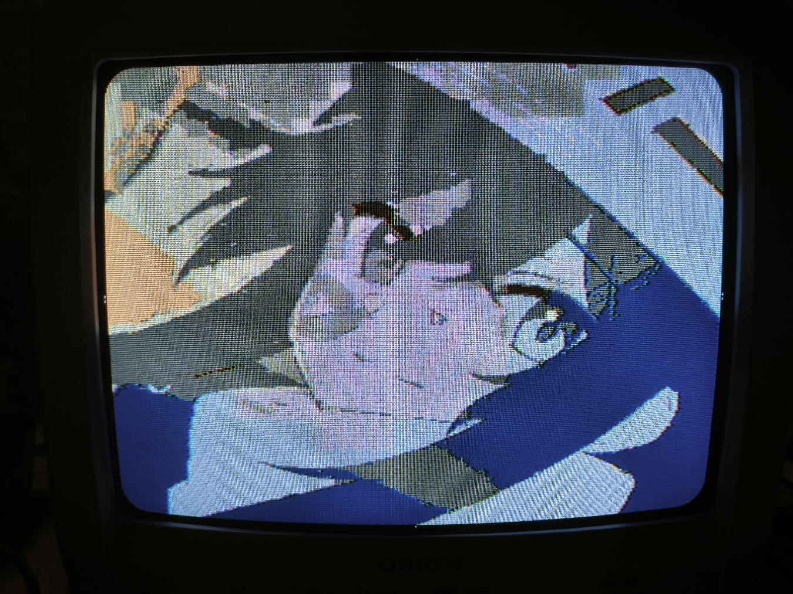
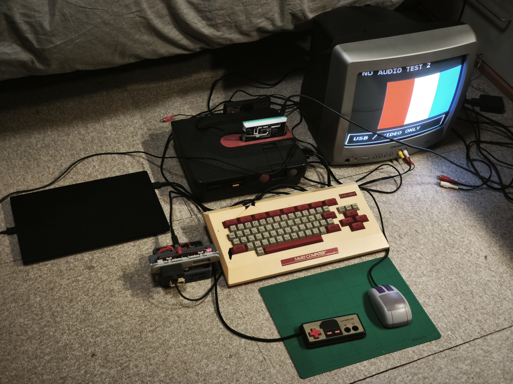

# 実機写真

ツインファミコン、ブラウン管テレビ、FC-MAGICONを組み合わせた製作者提供の写真。2026-10-18掲載。

## ツインファミコンとブラウン管での表示

FC-MAGICONを挿したツインファミコンとORIONのブラウン管テレビ。手前はファミリーベーシックキーボード。

## カートリッジの外観

白いケースに光沢紙のラベルを貼ったカートリッジ。Core2350B2、BOOTSEL／RESET、音量調整、デバッグ端子の位置が分かる。USB用のフラットケーブルも引き出している。

## ブラウン管で見るカラー映像

ブラウン管画面の接写。FC向けに変換したカラー映像の輪郭や濃淡が見える。

## USB映像テストと周辺機器

音声を停止して画像転送を切り分けた際の「NO AUDIO TEST 2 / USB / VIDEO ONLY」。手前にはファミリーベーシックキーボード、スーパーファミコンマウス、FCパッドを配置している。この色帯の写真は音声なしの診断時のもの。

[プロジェクトのREADMEへ](../README.md) ／ [達成状況と実機確認](milestones_20261018.md)
